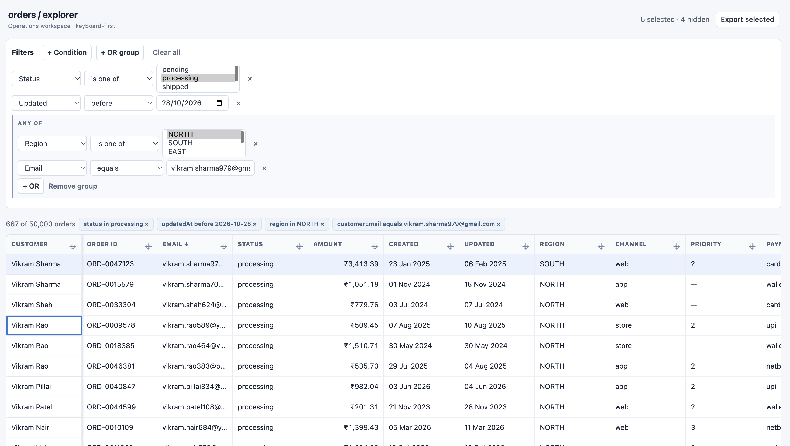
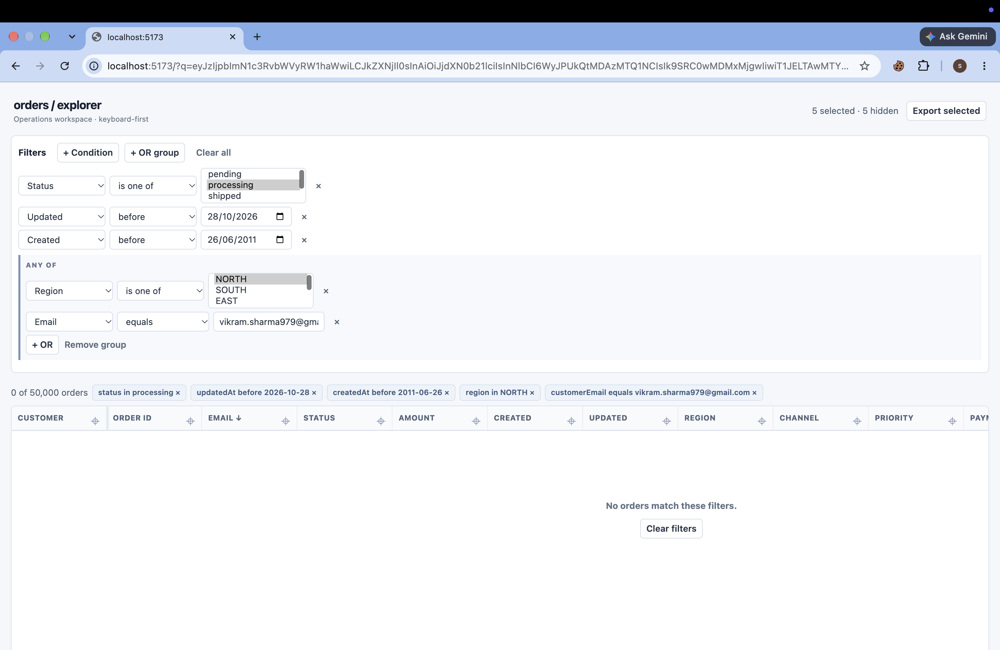

# Merkle Orders Explorer

A keyboard-first internal operations dashboard for approximately 50,000 messy order records.

## Run

```bash
npm install
npm run dev
npm run test
npm run build
```

## Design

Initial wireframes are in [design/normal-state.svg](design/normal-state.svg) and [design/empty-state.svg](design/empty-state.svg). The final design retains the compact filter-above-grid layout; a details drawer and visible selected/hidden count were added to make keyboard workflows clearer.

## Screenshots





## Implementation notes

- `public/orders.json` is the original, unmodified 17 MB source file, fetched once by the browser. It is normalized once after loading, then kept immutable. This avoids a backend while keeping the data pipeline explicit.
- Normalization centralizes date parsing, versioned fields/amount conversion, enum casing, whitespace cleanup, missing priorities, and deterministic duplicate removal.
- The grid is custom: fixed 38px rows, scroll-window computation with 8 rows overscan, sticky header, pointer resizing, one sticky pinned column, row selection, and keyboard cell navigation.
- Selection is independent of filters. Export always contains **all selected rows** (including hidden rows); the header explicitly reports hidden selections. CSV values are quoted and formula-prefixed values are neutralized.
- Filter groups are OR internally and AND with standalone conditions/groups. Incomplete conditions are ignored rather than applied unpredictably.
- URL state uses a validated, compact base64 JSON `q` parameter for filters, sorting, pinned field, and stable selected IDs. Bad URLs show a non-blocking fallback notice.

## Dependencies

Runtime dependencies: React and React DOM (UI), Vite and `@vitejs/plugin-react` (development/build). There are no table, grid, virtualization, or filter-builder dependencies. Vitest is used for unit tests.

## Performance

The DOM renders only the viewport plus 16 overscan rows. Filtering and sorting run once through memoized derived data; normalization does not repeat on render. The full source has 50,030 records before de-duplication.

## Known limitations

- The download and rendering path is deliberately client-side for this take-home scope; a production deployment could pre-normalize or stream the source.
- URL payloads containing hundreds of selected IDs can become long, as required state is persisted directly in the URL.
